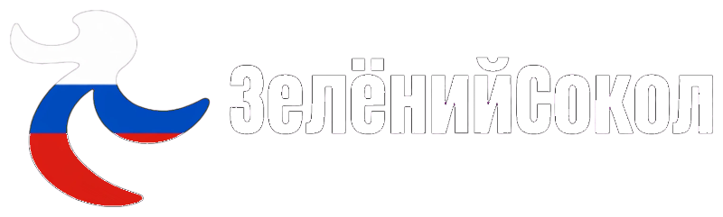

  

# ZelyonyySokol
<a href="https://zelyonyysokol.onrender.com/">Zelyonyysokol</a>
(or ЗелёнийСокол) is a Russian version of GronnFalk. ZelyonyySokol is a metasearch engine, just like GronnFalk, being a fork of it.
## Plug ins for GronnFalk

## Screenshots

 

## Credits

ZelyonyySokol is based on [GronnFalk](https://github.com/LiamProsser77/gronnfalk).

Original project created by LiamProsser77.
Most of this is also created by LiamProsser77.
